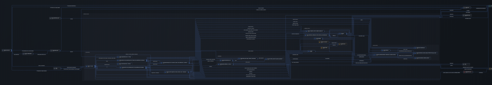

# Secure Data Pipeline Challenge (`cauce`)

## Summary (English)

`cauce` is a batch and streaming data pipeline for hourly electricity consumption: it takes dirty input files (four consumption formats, hostile master data, nested billing JSON) and loads them into a zoned Postgres star schema, plus a Redpanda consumer that emits alerts and exits on its own.
Stack: Python 3.13, Postgres 16, Redpanda and Terraform (AWS, validated, never applied), all driven by Docker Compose and `make`.
Key controls: PII is encrypted in the application (AES-256-GCM envelope plus HMAC blind index) from the very first write, three database roles with least privilege tested by logging in, and an append-only audit log (Bitácora) with a hash chain.
To run it, `make datos setup up run stream test down` generates synthetic dirty input and runs the whole contract (see the quick start below).
Docs and code are in Spanish.

## Qué es

Resuelto como take-home técnico de un proceso de selección (empresa anónima); el problema está reescrito en [`docs/brief.md`](docs/brief.md).

## Arranque rápido

Requisitos: Docker con Compose v2, `make` y los puertos `127.0.0.1:5432` (Postgres, configurable en `credenciales.yaml`) y `127.0.0.1:9092` (Redpanda) libres. `make datos` y `make setup` necesitan red la primera vez para construir la imagen.

```bash
make datos      # Datos sintéticos sucios en data/ (aborta si data/ ya tiene archivos)
make setup      # imagen cauce-app (python:3.13-slim por digest) + .venv del host con --require-hashes
make up         # genera credenciales.yaml si falta, estado/.env, Postgres + Redpanda sanos, roles y DDL
make run        # Corrida batch
make run        # idempotente: todo se omite por sha256 y out/ queda igual
make stream     # produce el ndjson, consume hasta el high watermark y termina solo
make test       # recrea cauce_test y corre unit + integración + e2e sobre Datos sintéticos en un temporal (no lee data/)
make down       # baja el stack; conserva volúmenes, out/ y logs/
```

`credenciales.yaml` queda fuera de git: `make up` lo genera con passwords aleatorios cuando falta. La rotación está en [`RUNBOOK.md`](RUNBOOK.md).

Por defecto la aplicación corre en el contenedor `app` ([ADR 0002](docs/adr/0002-stack-sin-minio-ni-pandas-con-runtime-docker.md)). `RUNTIME=local make <target>` usa el `.venv` del host con el mismo contrato de rutas.

## Targets

| Target | Qué hace |
|---|---|
| `make datos ARGS=...` | Variantes del generador: `--forzar` (pisa `data/`), `--mes AAAA-MM` (un mes nuevo no visto), `--corromper RUTA` (copia dañada de un archivo). `VERDAD=ruta` escribe la Verdad plantada; `CAUCE_DATA=ruta` cambia el directorio de datos (también para `run` y `stream`) |
| `make credenciales` | Completa los passwords de `credenciales.yaml`; `ROTAR=1` los reescribe todos |
| `make lint` | `ruff check` sobre `src/`, `tests/` y `tools/` |
| `make e2e` | El contrato completo desde cero (`make clean`, sin `out/` ni `logs/`) sobre Datos sintéticos en un temporal, con `out/` contrastado contra la Verdad plantada, más idempotencia de `down`/`up` y re-ejecución del stream |
| `make auditar` | `pip-audit` sobre `requirements*.txt` (necesita red) |
| `make auditar-salidas` | Busca PII con el detector estricto en el `out/` y los `logs/` reales |
| `make infra-validar` | `terraform fmt -check` + `init -backend=false` + `validate` en una imagen pinneada |
| `make infra-lock` | Regenera `infra/.terraform.lock.hcl` |
| `make clean` | Borra volúmenes, `out/`, `logs/` y `estado/.env` |

## Qué hace

| Brief | Cómo | Dónde mirar |
|---|---|---|
| **§3** Ingesta batch | Esquema por zona (`raw`, `quarantine`, `crypto`, `core`, `analytics`, `audit`) y estrella en `core`. Detecta encoding, separador, nombres de columna y unidad por archivo. Ingesta incremental por `(fuente, nombre, sha256)`: un archivo es una transacción. Lo que aparece en `data/consumos/` entra, sin lista fija de meses. Un archivo corrupto o modificado se rechaza entero, y los meses cargados no cambian. | `src/cauce/nucleo/fuentes.py`, `src/cauce/aplicacion/ingesta_archivo.py`, `sql/`, `docs/arquitectura/modelo-datos.dg` |
| **§4** Calidad (B1-B7) | Reglas exactas. B3, B5 y los agregados se resuelven en SQL sobre la base, así que `out/` se recalcula desde el estado y no sumando deltas. Las correcciones tardías se absorben por versión, sin recargar. | [`DECISIONS.md`](DECISIONS.md) (cubos B3, universo de Huecos), `core.v_hueco` |
| **§5** Seguridad (C1-C8) | Clasificación viva y fail-fast; AES-256-GCM en la aplicación con envelope y blind index HMAC; tres roles con grants mínimos probados conectándose; Bitácora append-only en tres capas con cadena de hash; Enmascarado de `observaciones` antes de persistir; auditoría del scaffolding heredado. | [`SECURITY.md`](SECURITY.md), [`THREAT_MODEL.md`](THREAT_MODEL.md) (STRIDE con mapeo al Anexo A de ISO/IEC 27001:2022), [ADR 0001](docs/adr/0001-pii-cifrada-desde-raw-y-minimizada.md) |
| **§6** Streaming | Detector de Alertas puro, con las tres reglas exactas, deduplicación por `evento_id` y validación del evento. Consume con `assign` hasta el high watermark tomado después de producir, con tope de 210 s. | `src/cauce/nucleo/alertas.py`, `src/cauce/aplicacion/corrida_stream.py` |
| **§7** Observabilidad | Logs JSON con catálogo cerrado de eventos y claves, y detector estricto de PII como red de seguridad en cada línea y en cada archivo de `out/`. Los conteos de `metrics.json` salen de la base, así que dos `make run` seguidos dan los mismos números; lo que hizo esa Corrida queda en `corrida`. | `src/cauce/bordes/observabilidad.py`, [`RUNBOOK.md`](RUNBOOK.md) |
| **§8** IaC | S3 `datos` y `auditoria` versionados con SSE-KMS, tres llaves KMS con key policies, roles IAM equivalentes a C4. `terraform validate` pasa. | [`infra/README.md`](infra/README.md) |

## Arquitectura

Módulos profundos con núcleo puro (`fuentes`, `pii`, `custodia`, `clasificacion`, `alertas`) y bordes con I/O (`almacen`, `bitacora`, `observabilidad`, `salidas`). `custodia.custodiar` es la única puerta hacia la base, y un test de capas impide que el núcleo importe I/O. Las pruebas usan un Postgres real (`cauce_test`), sin fakes. Vocabulario en [`GLOSSARY.md`](GLOSSARY.md).



## Diagramas

La fuente de la arquitectura, el modelo de datos y la infra Terraform está en `docs/arquitectura/*.dg`. Para verlos con [Rinthel-arch](https://github.com/WilliamBarriga/Rinthel-arch) (Node + pnpm):

```bash
git clone https://github.com/WilliamBarriga/Rinthel-arch docs/diagrams
(cd docs/diagrams && pnpm install && pnpm build)
node docs/diagrams/packages/cli/dist/bin.js dev --workspace docs/arquitectura   # http://127.0.0.1:4173/
```

## Límites y no implementado

No implementado:

- **Object Lock COMPLIANCE y CloudTrail con data events** en el Terraform. Quedan descritos como control propuesto en [`infra/README.md`](infra/README.md), sin HCL.

Límites actuales (detalle y riesgo residual en [`THREAT_MODEL.md`](THREAT_MODEL.md)):

- **La KEK vive en un archivo** (`estado/.env`, 0600), no en un KMS/HSM. Quien lea ese archivo y además tenga un dump puede descifrar. En AWS iría en KMS (`infra/`).
- **La rotación de llaves no está automatizada.** El esquema soporta `key_version`, pero no hay un comando que re-cifre con una DEK nueva.
- **Blind index de NIT:** si se filtra `K_bidx`, un diccionario de NITs es factible (el espacio es chico).
- **Stream:** las Caídas (`FRONTERA_SIN_REPORTE`) se confirman al cierre del stream, no en vivo (ver [`DECISIONS.md`](DECISIONS.md)).
- **No hay auditoría de lecturas.** La Bitácora registra Corridas, no las consultas de `analista` o `auditor`, y Postgres corre con `log_statement=none`. En producción iría `pgaudit` o los logs de la base gestionada.

## Cómo se construyó

El diseño se cerró antes de escribir código, con una revisión de arquitectura antes de construir y otra al final.
La construcción fue en slices verticales, test-first, cada uno cerrado con `make test` verde y `make lint` limpio.
Alrededor del 95% del código y de los documentos lo generó IA (Claude Code), dirigida y revisada por el autor.
El resumen está en [`AI_USAGE.md`](AI_USAGE.md) y el registro completo por slice, con cada error corregido, en [`docs/anexos/ai-usage-registro.md`](docs/anexos/ai-usage-registro.md).
Las decisiones, cada una con su alternativa descartada, están en [`DECISIONS.md`](DECISIONS.md) y en [`docs/adr/`](docs/adr/).

## Documentos

| Archivo | Contenido |
|---|---|
| [`docs/brief.md`](docs/brief.md) | El problema |
| [`DECISIONS.md`](DECISIONS.md) y [`docs/adr/`](docs/adr/) | Decisiones de diseño y de construcción, cada una con su alternativa descartada |
| [`SECURITY.md`](SECURITY.md) | Controles C1-C8 y hallazgos de la auditoría del scaffolding heredado |
| [`THREAT_MODEL.md`](THREAT_MODEL.md) | STRIDE sobre esta arquitectura, con mapeo a ISO/IEC 27001:2022 |
| [`RUNBOOK.md`](RUNBOOK.md) | Operación y qué hacer cuando falla |
| [`data_classification.yaml`](data_classification.yaml) | Clasificación por campo, que el pipeline consulta |
| [`AI_USAGE.md`](AI_USAGE.md) y [`docs/anexos/ai-usage-registro.md`](docs/anexos/ai-usage-registro.md) | Uso de IA: resumen y registro completo por slice |
| [`GLOSSARY.md`](GLOSSARY.md) | Términos del dominio usados en código, tests y documentos |
| [`LICENSE`](LICENSE) | Licencia MIT |

## Licencia

MIT, ver [`LICENSE`](LICENSE).
